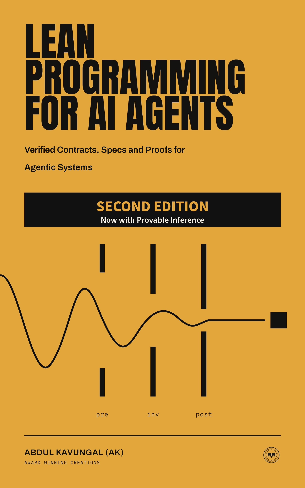

<p align="center">
  
</p>

<h1 align="center">Lean Programming for AI Agents</h1>

<p align="center">
  <em>Verified Contracts, Specs and Proofs for Agentic Systems</em><br>
  Second Edition: Now with Provable Inference<br>
  Abdul Kavungal (AK)<br>
  Award Winning Creations
</p>

<p align="center">
  <a href="https://github.com/abduljaleel/lean-programming-for-ai-agents/actions/workflows/build.yml"></a>
  
  
</p>

Ask an AI agent to do something and it will propose an action, usually with a confident explanation attached. Sometimes that explanation is wrong, and the hard part is putting Lean 4 in the loop: a language you can ship, and a kernel that can say no for a reason no amount of fluent argument can get around.

This repository is the companion Lake package for the book. Every Lean listing from the printed chapters lives here. Chapters 1 to 18 keep the first-edition examples, one folder per chapter, using the filenames the book uses. Part V, Provable Inference, adds chapters 19 to 24 as the `ProvableInference` library: toy models of the argument systems used to prove which committed model produced a reply, following the [FlashProve](https://github.com/anthropics/FlashProve/) setting.

`lake build` type-checks the live modules. Listings the book rejects, or that are not standalone modules, are quoted in `*_Fails.lean` files so the default build stays green.

## Book details

| | |
|---|---|
| Title | Lean Programming for AI Agents |
| Subtitle | Verified Contracts, Specs and Proofs for Agentic Systems |
| Edition | Second Edition: Now with Provable Inference |
| Author | Abdul Kavungal (AK) |
| Publisher | Award Winning Creations |
| Readers and code | [awardwinningcreations.com/lean-code](https://awardwinningcreations.com/lean-code) |
| Lean pin | 4.35.0 |

Public repository: https://github.com/abduljaleel/lean-programming-for-ai-agents

## Where to read

- Publisher: [awardwinningcreations.com](https://awardwinningcreations.com)
- Companion code: [awardwinningcreations.com/lean-code](https://awardwinningcreations.com/lean-code)

## Who this is for

Software engineers, researcher-engineers, and technical leads who build, check, or specify AI agents. If you are comfortable with types in any language (Rust, TypeScript, Haskell, OCaml, Kotlin, it does not matter), you have enough background. You do not need a mathematics degree.

## What you'll build

- The running `ToolCall`, `ToolResult`, and `Trace` types, from the first inductive chapter through the finished package
- Tool contracts as data: a `Prop` spec, a `Bool` checker, and a theorem that the boolean is sound
- Lake projects with a pinned `lean-toolchain`, plus a compiled checker that returns an exit code
- The Chapter 18 `myagent` package: `Myagent.Spec`, `Myagent.Tools`, `Myagent.Loop`, and `Main.lean`, with `lake exe checker --self-test`
- Part V: a relation and a trivial argument system; Merkle openings; sumcheck completeness; Fiat-Shamir; a toy mixture-of-experts trace checker whose accepted token is unique; a pipeline that admits only verified receipts; lookup tables; and a request ledger with a post-hoc audit queue

The kernel is the referee. Prose does not check.

## Quick start

1. Install [elan](https://elan.lean-lang.org/), which provides `lean` and `lake`:

```bash
curl https://elan.lean-lang.org/elan-init.sh -sSf | sh
source "$HOME/.elan/env"
elan --version
lean --version
lake --version
```

On Windows, use the elan PowerShell installer from https://elan.lean-lang.org/elan-init.ps1, or follow https://lean-lang.org/install/manual/.

2. Clone this repository:

```bash
git clone https://github.com/abduljaleel/lean-programming-for-ai-agents.git
cd lean-programming-for-ai-agents
```

3. Build. The first run downloads Lean 4.35.0 from the `lean-toolchain` pin.

```bash
lake build
lake exe checker --self-test
```

`lake build` type-checks every live module, including Part V. `lake exe checker --self-test` should print `ACCEPT self-test`.

4. Open the **folder** of this package in VS Code (or VSCodium) with the official **Lean 4** extension by `leanprover`. Neovim users should use `lean.nvim`. Open the package root, not a single file from a random path. The language server reads `lean-toolchain` and the lakefile from here.

This package does not depend on Mathlib. You do not need `lake exe cache get`.

## Chapter by chapter

Files named `*_Fails.lean` are quoted as comments so `lake build` stays green. Some are listings the book rejects on purpose (`sorry` fakes, strict positivity, the junk-drawer decoder). Others are fragments or sketches that need surrounding text, Aesop, or LeanCopilot. Each chapter folder's `README.md` lists every file.

There are 112 live modules and 266 quoted fail files. Appendices B, D, and E have no Lean listings (API cards, the URL register, and further study), so they are not folders here.

| Ch | Title | Folder | Key examples | Intentional fails |
|---|---|---|---|---|
| 1 | Why Lean for AI Agents | `Ch01_WhyLean/` | `nth.lean`, `inSandbox.lean`, `main.lean` | quoted fragments (`patch_ok_Fails.lean`, `Eval04_Fails.lean`, `Step_Fails.lean`) |
| 2 | Types, Terms, and the Kernel | `Ch02_TypesTermsKernel/` | `Certificate.lean`, `inc.lean`, `NonemptyString.lean` | `Fake_Fails.lean` (`sorry`; CI must reject it); other quoted fragments |
| 3 | Inductive Types, Structures, and Pattern Matching | `Ch03_InductiveTypes/` | `Vec.lean`, `Expr.lean`, `JValue.lean` | `Listing46_Fails.lean`, `Listing63_Fails.lean` (strict positivity); `decodeToolResultBad_Fails.lean` (junk-drawer decoder) |
| 4 | Typeclasses and Ad-hoc Polymorphism | `Ch04_Typeclasses/` | `Listing82.lean`, `Listing89.lean`, `Listing91.lean`, `Listing96.lean` | quoted `Capable` / gate sketches (`Capable_Fails.lean`, `gate_Fails.lean`) |
| 5 | Programming with `do`, Monads, and Effects | `Ch05_DoMonads/` | `main.lean`, `withLogging.lean`, `readLine.lean` | quoted `AgentM` / loop sketches |
| 6 | Propositions as Types and Tactics | `Ch06_PropTactics/` | `and_swap.lean`, `zero_add.lean`, `both.lean` | `fake_safe_Fails.lean` (`sorry`); other quoted fragments |
| 7 | Projects, Lake, Modules, and the 2026 Toolchain | `Ch07_LakeModules/` | `main.lean`, `ToolResult.lean`, `Listing191.lean` | module-system sketches that expect a standalone `Myagent` layout (`Myagent_Fails.lean`, `Myagent/Spec_Fails.lean`, `Myagent/SpecLemmas_Fails.lean`) |
| 8 | Metaprogramming I: Syntax, Macros, Elaborators | `Ch08_MetaprogrammingI/` | `Listing195.lean` through `Listing223.lean` | `Myagent/Syntax_Fails.lean`, `Myagent/Echo_Fails.lean` |
| 9 | Metaprogramming II: `MetaM`, `TermElabM`, Custom Tactics | `Ch09_MetaprogrammingII/` | `Basic.lean`, `Listing229.lean`, `Listing235.lean`, `Listing237.lean` | quoted tactic sketches |
| 10 | Automation: `grind`, Aesop, `simp`, `mvcgen` | `Ch10_Automation/` | `Example264.lean`, `sumTo.lean`, `AgentState.lean` | Aesop listings (`safe_of_ok_Fails.lean`, `Listing277_Fails.lean`, `Listing299_Fails.lean`); this repo does not vendor Aesop |
| 11 | Talking to Lean: REPL, LSP, Pantograph | `Ch11_REPL/` | `f.lean` | `Eval306_Fails.lean` |
| 12 | Python Interop, FFI, and Extracting Executables | `Ch12_PythonFFI/` | `crc32.lean`, `myAdd.lean`, `checkTrace.lean` | quoted fragments (`main_Fails.lean`, `Decoded_Fails.lean`) |
| 13 | Provers, APIs, and the kernel, 2024 to 2026 | `Ch13_Provers/` | (no live module) | `Listing314_Fails.lean` (LeanCopilot; not vendored) |
| 14 | Agents that Write Proofs | `Ch14_ProofAgents/` | `or_comm_term.lean`, `TextToText.lean` | `Listing315_Fails.lean` (LeanCopilot) |
| 15 | Autoformalization and Statement Matching | `Ch15_Autoformalization/` | `Json.lean` | weaker-statement traps (`readFilePre_weak_Fails.lean`, `readFilePre_weaker_Fails.lean`, `weak_any_ok_Fails.lean`) |
| 16 | Kernel-as-Referee: Contracts, Specs, and Tool Calls | `Ch16_Contracts/` | `Json.lean` | quoted contract sketches (`Contract_Fails.lean`, `Main_Fails.lean`) |
| 17 | Formally Specified Agent Loops | `Ch17_SpecifiedLoops/` | `NodeKind.lean`, `succs.lean`, `nid.lean` | `failingVerify_Fails.lean` as a quoted trajectory; other loop sketches |
| 18 | A Worked Agent, Pitfalls, and Production Reality | `Ch18_WorkedAgent/` | `Myagent/Spec.lean`, `Tools.lean`, `Loop.lean`, `Main.lean` | none |
| A | Command and tactic cheat sheet | `AppA_CheatSheet/` | (no live module) | cheat-sheet fragments (`inc_Fails.lean`, `Listing367_Fails.lean`) |
| C | `lakefile.toml` templates | `AppC_LakefileTemplates/` | `main.lean`, `myAdd.lean` | none |

Chapter 18 is also the executable: `lake exe checker --self-test`.

## Part V. Chapters 19 to 24

Part V is one Lake library, `ProvableInference`, because later chapters import earlier ones. See [`ProvableInference/README.md`](ProvableInference/README.md).

| Ch | Title | Code files |
|---|---|---|
| 19 | Provable inference: which model answered | [`ProvableInference.lean`](ProvableInference.lean) |
| 20 | Relations, verifiers, and the three properties | [`ProvableInference/Relation.lean`](ProvableInference/Relation.lean), [`ProvableInference/Amplify.lean`](ProvableInference/Amplify.lean) |
| 21 | Merkle openings, sumcheck, and Fiat-Shamir | [`ProvableInference/Merkle.lean`](ProvableInference/Merkle.lean), [`ProvableInference/Sumcheck.lean`](ProvableInference/Sumcheck.lean), [`ProvableInference/FiatShamir.lean`](ProvableInference/FiatShamir.lean) |
| 22 | A toy MoE layer, traces, and lookups | [`ProvableInference/Model.lean`](ProvableInference/Model.lean), [`ProvableInference/Lookup.lean`](ProvableInference/Lookup.lean) |
| 23 | An agent pipeline that refuses unproved output | [`ProvableInference/Pipeline.lean`](ProvableInference/Pipeline.lean) |
| 24 | Request budgets and post-hoc audit | [`ProvableInference/Ledger.lean`](ProvableInference/Ledger.lean) |

`ProvableInference.lean` reprints the axioms of every headline theorem in Part V. `Model.lean` is also used in Chapter 20, where uniqueness of greedy decoding is stated. `Ledger.lean` continues the pipeline from Chapter 23.

## Repo layout

```
lean-toolchain              # leanprover/lean4:v4.35.0
lakefile.toml
lake-manifest.json
LICENSE                     # MIT, for the Lean listings
CITATION.cff
CONTRIBUTING.md
assets/cover.jpg            # Second-edition Kindle front cover, 1600 x 2560
Ch01_WhyLean/
Ch02_TypesTermsKernel/
Ch03_InductiveTypes/
Ch04_Typeclasses/
Ch05_DoMonads/
Ch06_PropTactics/
Ch07_LakeModules/
Ch08_MetaprogrammingI/
Ch09_MetaprogrammingII/
Ch10_Automation/
Ch11_REPL/
Ch12_PythonFFI/
Ch13_Provers/
Ch14_ProofAgents/
Ch15_Autoformalization/
Ch16_Contracts/
Ch17_SpecifiedLoops/
Ch18_WorkedAgent/           # Myagent library + checker
  Myagent.lean
  Myagent/Spec.lean
  Myagent/Tools.lean
  Myagent/Loop.lean
  Main.lean
ProvableInference.lean      # Part V axiom audit
ProvableInference/          # Chapters 19 to 24
  Relation.lean
  Amplify.lean
  Merkle.lean
  Sumcheck.lean
  FiatShamir.lean
  Model.lean
  Lookup.lean
  Pipeline.lean
  Ledger.lean
AppA_CheatSheet/
AppC_LakefileTemplates/
.github/workflows/build.yml # lake build
.github/ISSUE_TEMPLATE/     # errata template
```

Where the book names a file (`Certificate.lean`, `Myagent/Spec.lean`, `Main.lean`, `ProvableInference/Relation.lean`), this repo uses that name. A live file that needed earlier definitions from the same chapter has a short preamble above the printed listing, marked as preamble, so you can still match it to the page.

## Troubleshooting

**`lake` or `lean` not found.** Source `~/.elan/env`, or add `$HOME/.elan/bin` to `PATH`. Open a new terminal after installing elan.

**Toolchain mismatch.** This package pins Lean 4.35.0 in `lean-toolchain`. If an editor shows a different version, you opened the wrong folder. Close the window and open this repository's root. `elan show` prints what the current directory requested.

**Mathlib cache.** This repository does not depend on Mathlib, so `lake exe cache get` is not part of the build. If you add Mathlib to a fork, copy *Mathlib's* `lean-toolchain`, then run `lake exe cache get` before `lake build`. Building Mathlib from source takes hours.

**`lake build` wants a network.** The first build downloads the Lean toolchain. After that, builds are local.

**A `*_Fails.lean` file looks empty of real code.** It is quoted on purpose. Uncomment it only if you want to see the kernel refuse the listing, and expect `lake build` to go red.

**VS Code InfoView is blank.** Install the Lean 4 extension by `leanprover`, open the package folder, and wait for elan to finish fetching 4.35.0.

## Contributing

Please file [GitHub issues](https://github.com/abduljaleel/lean-programming-for-ai-agents/issues) for errata in the book or in these listings. Use the errata issue template. See [CONTRIBUTING.md](CONTRIBUTING.md).

## Licence

The Lean listings in this repository are MIT. See [LICENSE](LICENSE).

The book text, cover art, and publisher roundel are copyright 2026 Abdul Jaleel Kavungal. All rights reserved. Published by Award Winning Creations, Melbourne, Australia.

To cite the book or this package, see [CITATION.cff](CITATION.cff).

## Errata

Known differences between earlier 4.32.0 listings and this 4.35.0 package, so `lake build` succeeds on current stable Lean:

1. `parseJson`: `String.drop` / `dropEnd` now return `String.Slice`. The listings append `.copy` to recover a `String`.
2. `checkReadFilePre_sound`: `simp` closes the `false` branch of `c.name == "read_file"`, so the first `contradiction` subgoal is gone.
3. `Main.lean`: stdin is `(← IO.getStdin).readToEnd`.
4. `Certificate.lean`: the amount goal uses `decide` rather than `omega`, which no longer unfolds the structure fields here.

If you find something else, open an errata issue.
